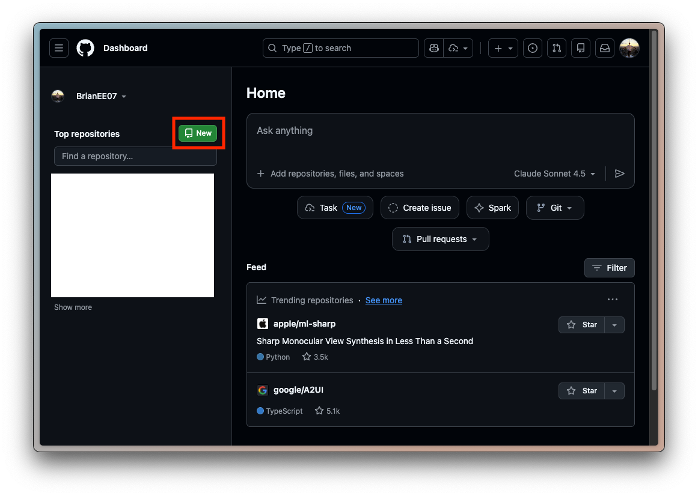
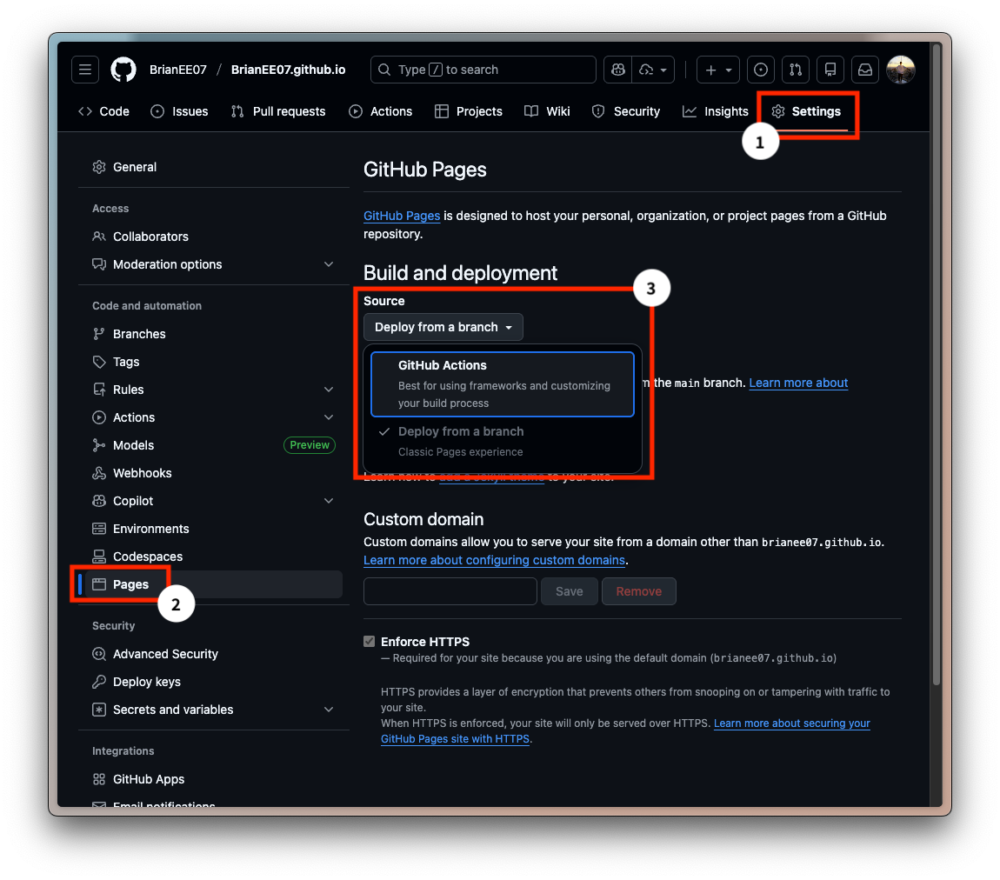
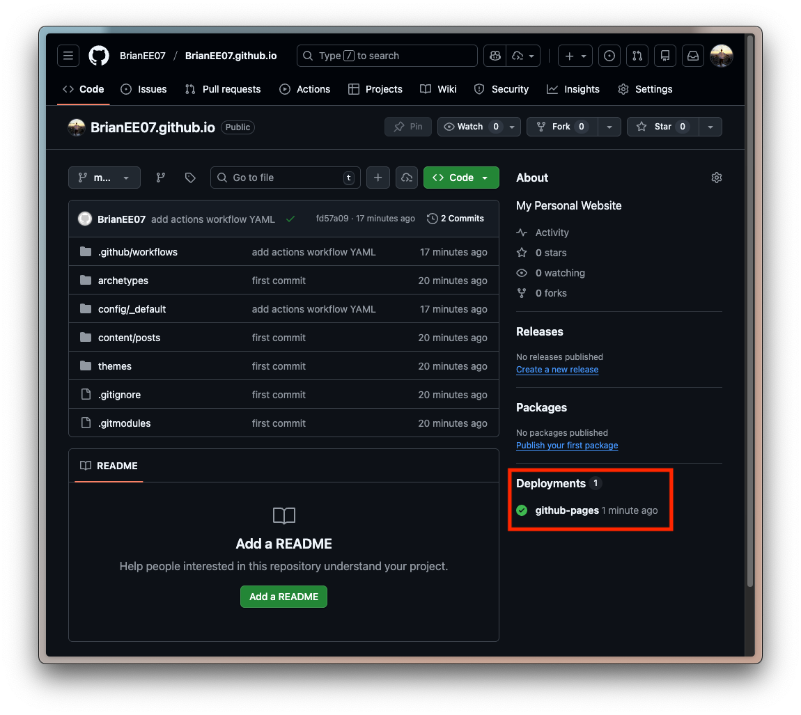

> In Part 1, we ran our first Hugo website locally.
>
> 👉 [Part 1: Running your first site locally with Hugo](/en/posts/self-hosted-website-with-hugo-and-github-pages-part-1/)
>
> This time, we will publish `Weisblog/` on GitHub Pages and let GitHub Actions build and deploy it. After that, we can preview a post locally and push it when it is ready.

## 1. What is GitHub Pages?

GitHub Pages is GitHub’s static website hosting service. If Hugo’s `public/` directory is the house, GitHub Pages is the land it sits on. Free land? Hard to say no to that. XD


## 2. Create the Weisblog repo and understand its URL

Create a public repository named `Weisblog` on [GitHub](https://github.com/). This is the example name for this guide. Replace every `<username>` below with your own GitHub username.



*The New repository button on the GitHub dashboard.*

The default Pages URL depends on the repository name:

| Type | Repository name | Default URL |
| --- | --- | --- |
| User site | `<username>.github.io` | `https://<username>.github.io/` |
| Project site | `Weisblog` | `https://<username>.github.io/Weisblog/` |

Each account can have one user site, while project sites are configured per repository. We are using a **project site**, so the repo does not have to be named `<username>.github.io`. See [GitHub’s naming rules](https://docs.github.com/en/pages/getting-started-with-github-pages/what-is-github-pages).

With a custom domain configured, the same project site can serve its content at `https://blog.yungwei.com/`, without `/Weisblog/`. We will do that in Part 3; keep these two URL structures separate for now.

Leave README, license, and `.gitignore` initialization unchecked when creating the repo. That avoids starting with separate initial histories on GitHub and your computer.

## 3. Choose one deployment method

I started by copying `public/` manually. Repeating that for every update became tedious, so I switched to GitHub Actions. I recommend going straight to [Method 2](#method-2-automatic-deployment-with-github-actions). Method 1 is here for anyone who wants to understand the publishing steps first.

### Method 1: Publish the built files manually

With this approach, your local `Weisblog/` keeps the Hugo source, while the GitHub `Weisblog` repo holds only the generated website. Use a separate local folder for the output so you do not mix the two.

Run these commands from the parent directory beside `Weisblog/`, replacing the username first:

```shell
mkdir Weisblog-public
cd Weisblog-public
git init
git branch -M main
git remote add origin "https://github.com/<username>/Weisblog.git"
cd ../Weisblog
```

> [!tip]
> Set only the posts you intend to publish to `draft = false`, or `draft: false` with YAML frontmatter. Keep all other drafts as they are.

Set the existing `baseURL` in `config/_default/hugo.toml` to your project site URL:

```toml
baseURL = "https://<username>.github.io/Weisblog/"
```

The `rsync --delete` command below removes files from the output folder when they are no longer present in `public/`. Its destination must be the new `Weisblog-public/` folder, never your source or another project.

```shell
hugo --cleanDestinationDir
rsync -av --delete --exclude='.git/' public/ ../Weisblog-public/
touch ../Weisblog-public/.nojekyll
cd ../Weisblog-public
git add .
git commit -m "Publish Hugo site"
git push -u origin main
```

In the repo’s `Settings` → `Pages`, choose **Deploy from a branch**, with `main` and `/ (root)`. The `.nojekyll` file tells GitHub to serve the static files without treating them as a Jekyll project.

Once deployment succeeds, open the URL shown on the Pages screen and check `/Weisblog/posts/` and its images. For future updates, repeat the build, sync, and push from the Hugo project.

If you choose this method, stop here. Switching to Actions requires replacing the deployment repo’s files with the Hugo source, keeping its `.git` history and reviewing the differences. Do not continue with the following commands from the output folder.

### Method 2: Automatic deployment with GitHub Actions

This approach pushes the complete Hugo source project `Weisblog/` to the matching repo and lets GitHub build and publish it. There is no need to upload local `public/` files. The [official Hugo deployment guide](https://gohugo.io/host-and-deploy/deploy-to-github-pages/) follows this process too.

These instructions start after Part 1, before pushing anything with Method 1. Create `.gitignore` in `Weisblog/`:

```gitignore
public/
resources/
.hugo_build.lock
.DS_Store
```

We already ran `git init` while installing the theme. Confirm you are in the Hugo source folder, then connect it to the empty repository:

```shell
git remote -v
git remote add origin "https://github.com/<username>/Weisblog.git"
git branch -M main
git add .
git commit -m "Add Hugo project"
git push -u origin main
```

If `git remote -v` already lists `origin`, check its destination. Skip `remote add` if it is correct. Use `git remote set-url origin <your-repo-URL>` only when you intend to change it.

Open the `Weisblog` repo’s `Settings` → `Pages` → `Build and deployment` and set Source to **GitHub Actions**. There is no need to run Jekyll first or expect an initial failure as part of setup.



*Older example: the repo name differs; select GitHub Actions here.*

Create the workflow file in your local `Weisblog/`:

```shell
mkdir -p .github/workflows
touch .github/workflows/hugo.yaml
```

Save the following in `.github/workflows/hugo.yaml`. This example pins Hugo 0.168.0, meeting Blowfish’s current minimum requirement. It is not a claim that this version will always be the latest. If your local setup or theme later needs a newer version, update `HUGO_VERSION` and its download filename, and check the other dependencies against the theme’s requirements. The build time zone is Taipei.

```yaml
name: Build and deploy
on:
  push:
    branches:
      - main
  workflow_dispatch:
permissions:
  contents: read
  pages: write
  id-token: write
concurrency:
  group: pages
  cancel-in-progress: false
defaults:
  run:
    shell: bash
jobs:
  build:
    runs-on: ubuntu-latest
    env:
      DART_SASS_VERSION: 1.97.1
      GO_VERSION: 1.25.5
      HUGO_VERSION: 0.168.0
      NODE_VERSION: 24.12.0
      TZ: Asia/Taipei
    steps:
      - name: Checkout
        uses: actions/checkout@v5
        with:
          submodules: recursive
          fetch-depth: 0
      - name: Setup Go
        uses: actions/setup-go@v5
        with:
          go-version: ${{ env.GO_VERSION }}
          cache: false
      - name: Setup Node.js
        uses: actions/setup-node@v4
        with:
          node-version: ${{ env.NODE_VERSION }}
      - name: Setup Pages
        id: pages
        uses: actions/configure-pages@v5
      - name: Create directory for user-specific executable files
        run: |
          mkdir -p "${HOME}/.local"
      - name: Install Dart Sass
        run: |
          curl -sLJO "https://github.com/sass/dart-sass/releases/download/${DART_SASS_VERSION}/dart-sass-${DART_SASS_VERSION}-linux-x64.tar.gz"
          tar -C "${HOME}/.local" -xf "dart-sass-${DART_SASS_VERSION}-linux-x64.tar.gz"
          rm "dart-sass-${DART_SASS_VERSION}-linux-x64.tar.gz"
          echo "${HOME}/.local/dart-sass" >> "${GITHUB_PATH}"
      - name: Install Hugo
        run: |
          curl -sLJO "https://github.com/gohugoio/hugo/releases/download/v${HUGO_VERSION}/hugo_${HUGO_VERSION}_linux-amd64.tar.gz"
          mkdir "${HOME}/.local/hugo"
          tar -C "${HOME}/.local/hugo" -xf "hugo_${HUGO_VERSION}_linux-amd64.tar.gz"
          rm "hugo_${HUGO_VERSION}_linux-amd64.tar.gz"
          echo "${HOME}/.local/hugo" >> "${GITHUB_PATH}"
      - name: Verify installations
        run: |
          echo "Dart Sass: $(sass --version)"
          echo "Go: $(go version)"
          echo "Hugo: $(hugo version)"
          echo "Node.js: $(node --version)"
      - name: Install Node.js dependencies
        run: |
          if [[ -f package-lock.json || -f npm-shrinkwrap.json ]]; then
            npm ci
          fi
      - name: Configure Git
        run: |
          git config core.quotepath false
      - name: Cache restore
        id: cache-restore
        uses: actions/cache/restore@v4
        with:
          path: ${{ runner.temp }}/hugo_cache
          key: hugo-${{ github.run_id }}
          restore-keys:
            hugo-
      - name: Build the site
        run: |
          hugo \
            --gc \
            --minify \
            --baseURL "${{ steps.pages.outputs.base_url }}/" \
            --cacheDir "${{ runner.temp }}/hugo_cache"
      - name: Cache save
        id: cache-save
        uses: actions/cache/save@v4
        with:
          path: ${{ runner.temp }}/hugo_cache
          key: ${{ steps.cache-restore.outputs.cache-primary-key }}
      - name: Upload artifact
        uses: actions/upload-pages-artifact@v3
        with:
          path: ./public
  deploy:
    environment:
      name: github-pages
      url: ${{ steps.deployment.outputs.page_url }}
    runs-on: ubuntu-latest
    needs: build
    steps:
      - name: Deploy to GitHub Pages
        id: deployment
        uses: actions/deploy-pages@v4
```

Yes, it is long. XD Start with the main steps: Checkout includes the theme submodule, Build creates `public/`, Upload transfers the output, and Deploy publishes it. `--baseURL` uses the URL returned by Pages, so it follows either the project site or Custom domain setting.

Also update the existing `baseURL` in `config/_default/hugo.toml` so local production builds use the correct address. Edit the existing key instead of adding a duplicate. Before configuring a custom domain, use:

```toml
baseURL = "https://<username>.github.io/Weisblog/"

[caches]
  [caches.images]
    dir = ':cacheDir/images'
```

`caches.images` stores Hugo image-processing results, so operations such as Resize, Fit, and Fill do not have to start over each time. The workflow’s Cache restore/save steps share that cache between Actions runs.

> [!tip]
> Set posts intended for publication to `draft: false` (`draft = false` in TOML), keeping other drafts unchanged.

> [!important]
> Preview public content with `hugo server`; add `-D` only when you need to inspect drafts. The production workflow does not use `-D`.

Then push:

```shell
git add .
git commit -m "Add Pages deployment workflow"
git push
```

Check that both build and deploy succeed in Actions, then open the URL provided by Pages. A green checkmark means the workflow completed. You still need to check pages, navigation, and images yourself; the workflow cannot judge whether the writing is correct.



*Older example: the repo name differs; deployment results appear under Deployments on the right.*

For later updates, preview locally, review what you are committing, and push. If the URL includes `/Weisblog/`, article and asset links must keep that prefix too. Hugo’s `relURL`/`relref` can generate links in templates and content; hard-coding `/posts/` would instead point to the account’s root site.

#### Troubleshooting

I once had GitHub reject a workflow push because my classic token lacked the `workflow` scope:

```text
refusing to allow a Personal Access Token to create or update workflow
.github/workflows/hugo.yaml without workflow scope
```

If you use HTTPS with a classic token, check its `repo` and `workflow` scopes under GitHub personal `Settings` → `Developer settings` → `Personal access tokens`. With a fine-grained token, check Contents and Workflows write access for the target repo. A rejected push is different from an Actions build failure; first identify where it failed.

If macOS keeps using an old credential, find the matching account’s `github.com` entry in Keychain Access and update it before pushing again. I have also used `security delete-internet-password -s github.com` to clear an old credential. With multiple accounts, identify the right entry in Keychain first. The complete token is shown only once; store it and do not put it in the repo.

## 4. Use your own domain

You now have a site at `https://<username>.github.io/Weisblog/`. Next, we will connect it to `blog.yungwei.com`, using **Was Wei weiß** as the site name. The address is a configuration example; substitute a domain you own.

> 👉 [Part 3: Namecheap registration, Cloudflare DNS, and a custom GitHub Pages domain](/en/posts/self-hosted-website-with-hugo-and-github-pages-part-3/)

### What if I change hosting providers later?

Keep the Markdown and images, then adjust the deployment workflow, `baseURL`, and DNS. If the new host builds the site itself, disable only this Pages workflow; do not delete the entire `.github/workflows/` directory, which may contain other jobs. If URLs or paths change too, old links need redirects and search indexing needs attention. Part 3 and Part 4 cover those next.
