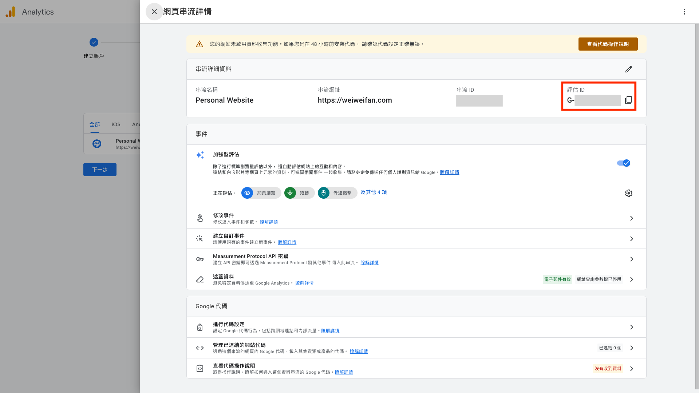
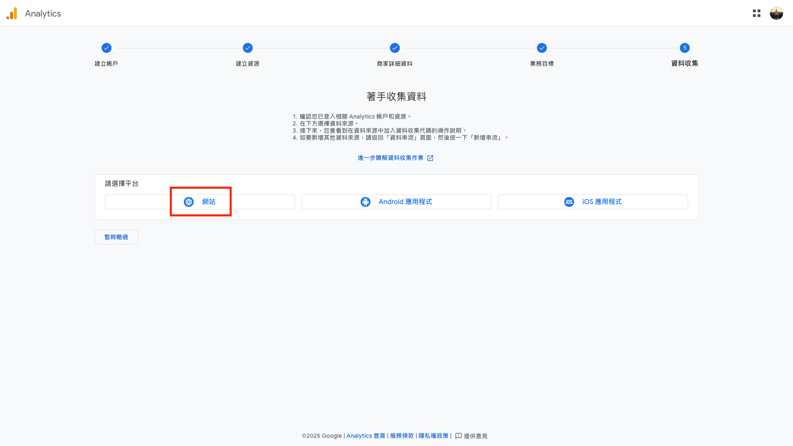
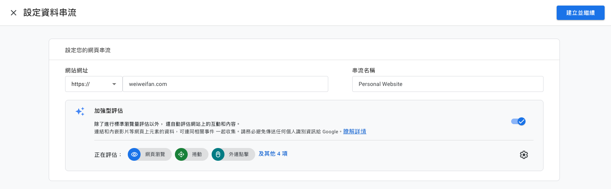
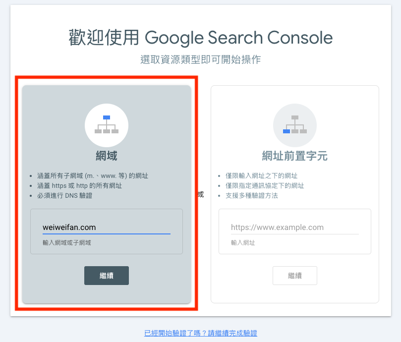
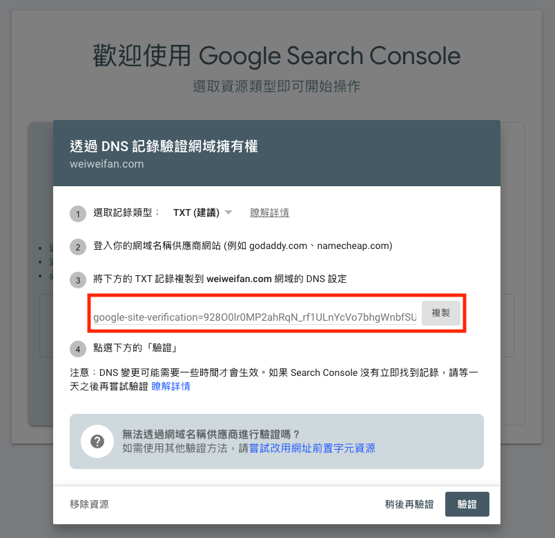
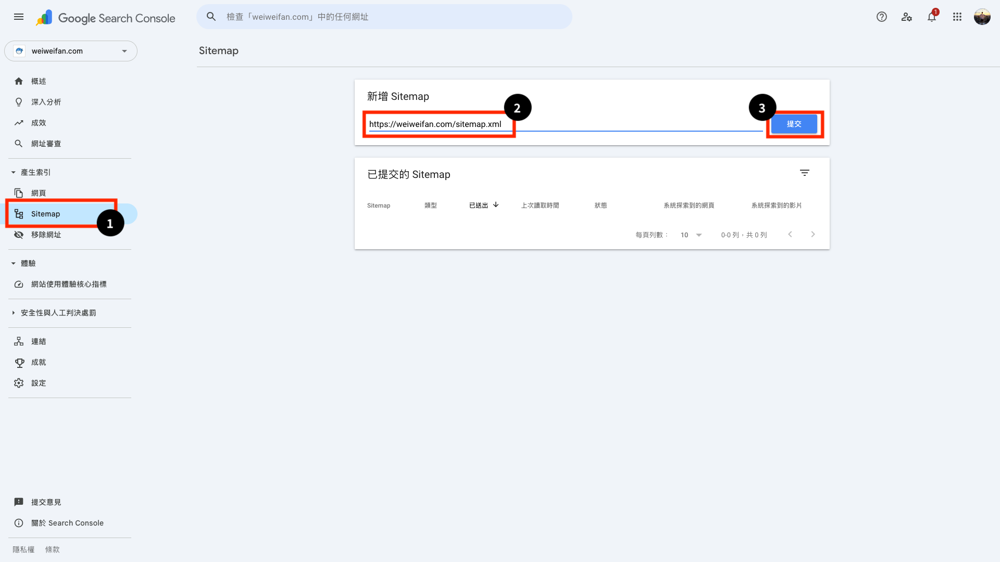
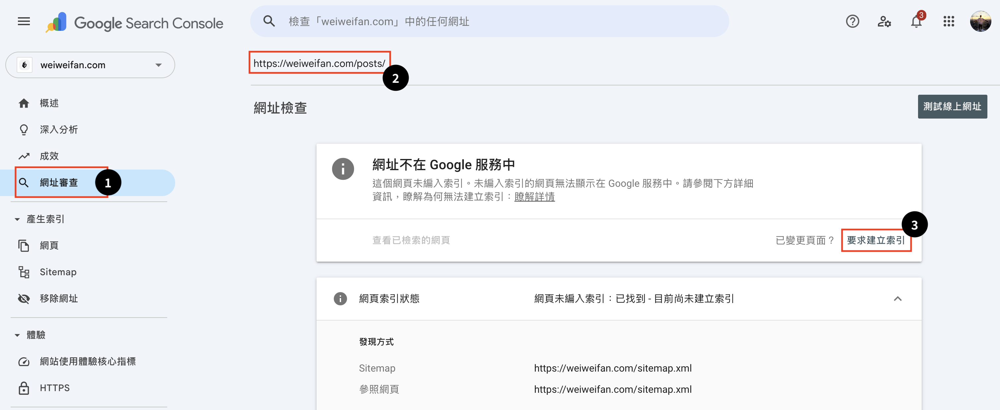

> In Part 3, we connected GitHub Pages to our own domain.
>
> 👉 [Part 3: Namecheap registration, Cloudflare DNS, and a custom GitHub Pages domain](/en/posts/self-hosted-website-with-hugo-and-github-pages-part-3/)
>
> Once the site is online, I also want to know whether people are reading it and where they find the posts. Here we will set up Google Analytics 4 (GA4) and Google Search Console, using `https://blog.yungwei.com/` and the site name Was Wei weiß throughout.

## 1. GA4: Traffic and user behavior


GA4 helps you examine traffic sources, page views, and interaction events. Sign in to [Google Analytics](https://analytics.google.com/analytics/) and find the site you intend to manage.

### If you already have GA4, find the existing property and stream

When the same site changes its name or domain, start with its existing property and web data stream. Do not create another set merely because the name changed and split future data across properties.

1. Select the GA4 property that already tracks this website.
2. Open Admin → Data collection and modification → Data streams, then select the existing web stream.
3. Edit its details, using `https://blog.yungwei.com/` as the website URL. You can rename the stream to `Was Wei weiß`.
4. Keep the Measurement ID from that same stream, in the form `G-XXXXXXXXXX`, and continue using it in Hugo.



*Older example: the domain and stream name differ; Measurement ID is at the top right.*

Property and stream names are labels. The installed ID determines where events are sent. Updating the URL in Admin does not install tracking on the website. See [Google’s stream editing instructions](https://support.google.com/analytics/answer/9304776?hl=en).

### Create a property and stream only for a first-time setup

If you have no GA4 setup, follow the [initial setup instructions](https://support.google.com/analytics/answer/9304153?hl=en): create an account and property, then add a Web stream. Choose an account name and set the reporting time zone and currency to fit your needs.



*Choose Web when creating your first stream.*

| Field | Example or value |
| --- | --- |
| Property name | `Was Wei weiß`, or a name you recognize |
| Platform | Web |
| Website URL | `https://blog.yungwei.com/`; if the protocol is a separate field, select HTTPS and enter only `blog.yungwei.com` in the URL field |
| Stream name | `Was Wei weiß` |
| Measurement ID | Use the generated `G-...` value, not this article’s placeholder |



*Older example: the URL and stream name differ; enter your own production URL.*

I originally used the site’s domain as its property name, which also works. The label does not have to stay tied to the URL. If you already have an account, you do not need a new one for every website either.

## 2. Add the Measurement ID to Hugo

With Blowfish, you do not need to edit the theme’s `<head>` or paste a second complete GA script. Configure `Weisblog/config/_default/hugo.toml`:

```toml
[services]
  [services.googleAnalytics]
    id = "G-XXXXXXXXXX"
```

Replace the placeholder with your own ID. If `[services]` or `[services.googleAnalytics]` already exists, edit that section rather than declaring it twice. Refer to [Hugo’s services configuration](https://gohugo.io/configuration/services/) and [Blowfish’s configuration guide](https://blowfish.page/docs/configuration/).

### How does the theme turn that setting into tracking code?

When I inspected the Blowfish version I was using, its `layouts/partials/head.html` loaded analytics only in production:

```go-html-template
{{/* Analytics */}}
{{ if hugo.IsProduction }}
  {{ partial "analytics/main.html" . }}
{{ end }}
```

Then `analytics/main.html` checked for the GA ID:

```go-html-template
{{ if site.Config.Services.GoogleAnalytics.ID }}
  {{ partial "analytics/ga.html" . }}
{{ end }}
```

Finally, `analytics/ga.html` inserted the configured ID into the Google tag:

```html
<script async src="https://www.googletagmanager.com/gtag/js?id={{ site.Config.Services.GoogleAnalytics.ID }}"></script>
<script>
  window.dataLayer = window.dataLayer || [];
  function gtag(){dataLayer.push(arguments);}
  gtag('js', new Date());
  gtag('config', '{{ site.Config.Services.GoogleAnalytics.ID }}');
</script>
```

These snippets explain the theme’s behavior. **Do not paste them into your post or layout again.** File locations and contents can change between theme versions; use the version you have installed as the reference.

Ordinary `hugo server` uses the development environment. The production check above prevents GA from loading in that local preview. Explicitly choosing production or adding another tracking snippet can still send test events. Production builds use the production environment; before publishing, check that the ID and tracking have not been disabled.

If you use the Actions workflow from Part 2, preview and review the changes, then push to rebuild the site:

```shell
git add .
git commit -m "Configure Google Analytics"
git push
```

### Verify that events reach the correct stream

After publishing, open your production website and watch the same GA4 property’s Realtime report for events matching your test time. If needed, use [Google Tag Assistant](https://tagassistant.google.com/) to check the ID and page URL, including whether tracking was installed twice.

A “data collection enabled” message or a nonzero active-user count alone does not prove the new domain is configured correctly. Those events could come from an old URL or another page. Check the ID, production page, and actual events together. Tracking blockers, consent settings, and reporting delays can also affect whether you see a test immediately.

## 3. Search Console: Search indexing


[Google Search Console](https://search.google.com/search-console/about) shows search impressions, clicks, index status, and website issues. GA4 covers behavior after visitors arrive, while Search Console helps examine the Google Search side.

> [!info]- What is SEO?
> SEO means search engine optimization: making content and site structure easier for search engines to understand. Ownership verification does not guarantee rankings or immediate indexing.

### Check what your existing property covers

Start with existing Search Console properties too, but their scope differs from GA4. GA4 can keep tracking the moved site through the original stream; Search Console properties cover a defined domain or URL prefix.

| Existing property | Does it cover `https://blog.yungwei.com/`? |
| --- | --- |
| Domain property `yungwei.com` | Yes, including its subdomains and protocols |
| Domain property `blog.yungwei.com` | Yes, it covers this subdomain |
| URL-prefix `https://blog.yungwei.com/` | Yes, it covers this HTTPS prefix |
| Another domain, or URL-prefix `https://yungwei.com/` | No; use a property that covers the blog’s new URL |

You do not need to recreate properties every time, but renaming an old domain’s property does not verify a new domain. Keep old properties for their history, and switch to a property covering the new URL for the following steps. See [Google’s property scope rules](https://support.google.com/webmasters/answer/34592?hl=en).

### Add and verify a property when none fits

If you manage DNS and want coverage for the whole domain, add a Domain property for `yungwei.com`, without a protocol or path. To focus on the blog alone, you can use URL-prefix `https://blog.yungwei.com/`. If you still use the default project site, enter `https://<username>.github.io/Weisblog/` instead.



*Older example: the domain differs; the two property options are in the same place.*

I previously chose DNS verification for my custom domain. For a Domain property covering `yungwei.com`, copy the verification value provided by Google and add it in **Cloudflare’s `yungwei.com` zone**:



*Older example: the domain and DNS provider differ; copy your own TXT value.*

| Field | Value |
| --- | --- |
| Type | `TXT` |
| Name | `@`, the apex domain being verified here |
| Content | The complete `google-site-verification=...` value provided by Google |
| TTL | `Auto` |

If the Domain property is instead `blog.yungwei.com`, follow its verification instructions and place the record at `blog`, rather than always entering `@`. This TXT record verifies ownership; the routing CNAME from Part 3 cannot replace it. Do not overwrite other TXT records.

Return to Search Console and verify. If it fails initially, check the TXT name and content and confirm Cloudflare is the authoritative DNS provider before waiting for propagation. Keep the verification record afterward; Google may check it again.

URL-prefix properties can use an HTML tag, file, or eligible GA verification, among other methods. Having GA4 does not automatically guarantee verification; the account permissions and tag must meet Google’s requirements. Choose an appropriate method from [Google’s ownership verification guide](https://support.google.com/webmasters/answer/9008080?hl=en).

## 4. Submit the sitemap and inspect individual posts

> [!info]+ What is sitemap.xml?
> `sitemap.xml` is a list of URLs provided to search engines.
>
> Hugo generates sitemaps. Start with `/sitemap.xml` at the site root. A multilingual site may have a sitemap index linking to each language’s sitemap. For this example:
>
> ```text
> https://blog.yungwei.com/sitemap.xml
> ```

Open it in a browser first. Confirm it does not return 404 and that its URLs use the production domain. A local production build writes the corresponding `public/sitemap.xml`; an incorrect `baseURL` can also produce incorrect URLs in the sitemap.

In the Search Console property covering the new URL, open Sitemaps and submit the complete sitemap URL. Check its later fetch status and errors; any language-specific child sitemaps must be accessible too.



*Older example: the domain differs; submit the new site’s sitemap URL.*

Google explains that [sitemaps help discover URLs but do not guarantee crawling or indexing](https://developers.google.com/search/docs/crawling-indexing/sitemaps/overview). A successful submission means Google can process the list, not that every article is already indexed.

To inspect an individual post, paste its production URL into URL Inspection and review Google’s known index status. You can test the live URL and request indexing when needed. New content may take time, without a fixed completion deadline.



*Older example: the URL differs; inspect the production URL of the post you want to check.*

You can also try searching Google for:

```text
site:blog.yungwei.com
```

That is a quick look at some results, not a complete index inventory. Use URL Inspection to examine a particular article.

If you are changing domains, also retain the old property, check one-to-one redirects from old posts to new posts, and update canonical URLs and internal links. Use the Change of Address tool when eligible, following [Google’s site-move guide](https://developers.google.com/search/docs/crawling-indexing/site-move-with-url-changes). Deleting the old property is not a migration step.

We now have instructions for the basic workflow: building locally with Hugo, deploying through GitHub Pages, adding a custom domain, and setting up traffic measurement and search indexing. Next, I will continue with Blowfish layout customization and more advanced Hugo usage.
